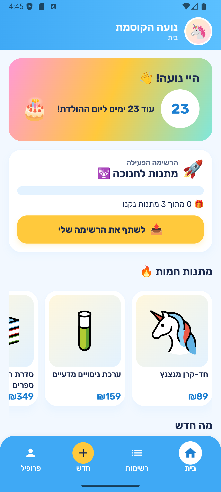
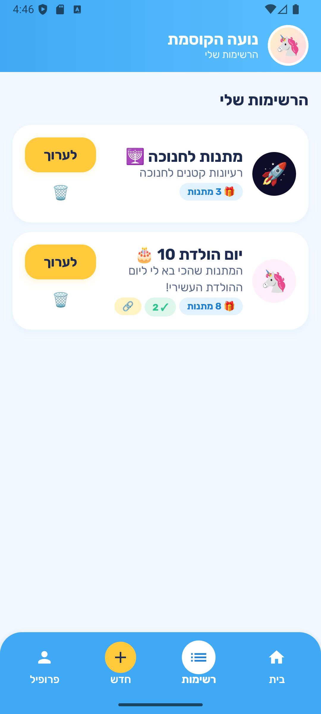
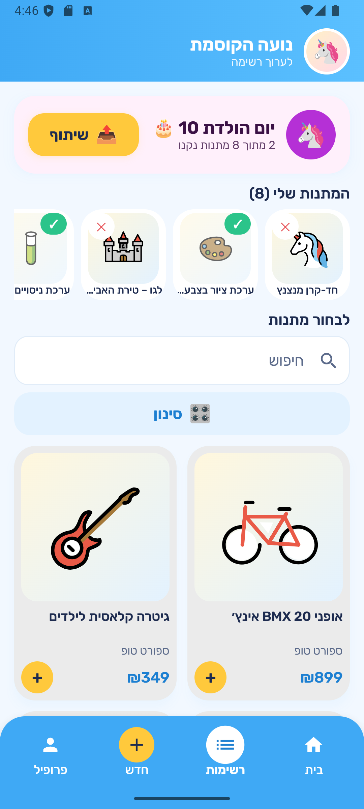
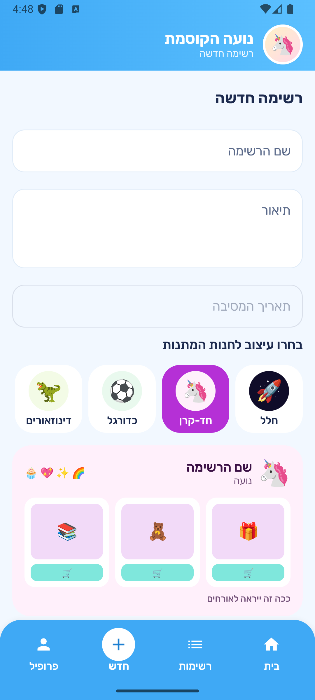
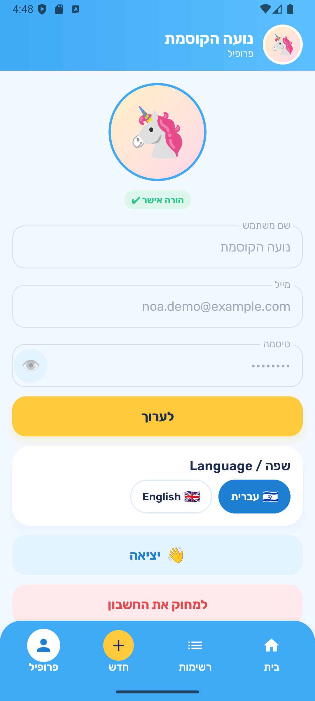

# 🎁 Birthday Wish List · רשימת משאלות ליום הולדת

Kids build birthday wish lists from real products that local shops have in stock. They share a link, and family and friends buy from the list in a themed gift shop. Shops connect their stock through an API and fulfil the orders.

## Live

| What | URL |
|---|---|
| Guest gift shop (demo list) | https://guyka2212.github.io/birthday-wish-list/l/J0QGHvwPtnxtaNaq77SUCW |
| Shop portal + admin (`/shop/admin/login`) | https://guyka2212.github.io/birthday-wish-list/shop/ |
| Shop API docs | https://guyka2212.github.io/birthday-wish-list/shop/docs |
| API (Vercel) · OpenAPI spec | https://birthday-wish-list-api.vercel.app · [/openapi.json](https://birthday-wish-list-api.vercel.app/openapi.json) |
| Android APK (latest `main`) | https://github.com/guyka2212/birthday-wish-list/releases/tag/latest-apk |

Demo logins (kid, shop, admin) are created by the seed script and saved to the gitignored `apps/api/.env.demo`. They are never committed.

<p>
  
  
  
  
  
</p>

| Part | Folder | Stack |
|---|---|---|
| Kid app (Android) | `apps/kid-android` | Kotlin, Compose Multiplatform, RTL Hebrew |
| Guest gift shop + bill page | `apps/web-guest` | Vite, React, TypeScript, Tailwind |
| Shop portal + admin + API docs | `apps/web-shop` | Vite, React, TypeScript, Tailwind |
| Backend API | `apps/api` | Hono, zod, libSQL client, Argon2id, JWT |
| Shared types, schemas, themes, VAT | `packages/shared` | TypeScript, zod |
| Database schema | `db/migrations` | SQL migrations for Turso (libSQL) |

## Architecture

```
 Android kid app            web-guest (GitHub Pages)        web-shop (GitHub Pages)
 Compose · RTL · he/en      themed gift shop · bill/PDF     shop dashboard · admin · docs
        \                            |                               /
         \_____ HTTPS JSON ── JWT · guest session · X-Api-Key ______/
                                     |
                     apps/api — Hono on Vercel (Node runtime)
       auth · lists · catalog · share links · reservations (15 min) · checkout
       PaymentProvider (fake) · EmailProvider (outbox | Resend) · AES-256-GCM
       Argon2id · rate limiting · CORS allowlist · audit log
                                     |
                         Turso / libSQL  (token only on the server)
```

The browser and the phone never see the Turso token. All data goes through the API.

## Run everything locally (one command)

```bash
npm install
cp apps/api/.env.example apps/api/.env   # then fill in the secrets (see the file)
npm run db:reset                         # migrate and seed the local database
npm run dev                              # API :4000 · guest :5173 · shop :5174
```

- Local dev uses a local libSQL file (`apps/api/local.db`). Set `DB_MODE=remote` in `.env` to use Turso.
- Android: open `apps/kid-android` in Android Studio and run `androidApp`, or run `./gradlew :androidApp:installDebug`. Debug builds call `http://10.0.2.2:4000` (the API on your PC).

## Deploying

- **Websites:** pushing to `main` runs `.github/workflows/pages.yml`, which builds both sites with `VITE_API_URL` taken from the `API_URL` repo variable.
- **API:** run `npm run build -w @bwl/api`, copy `apps/api/deploy/` to a folder **outside** the repo, then run `npx vercel deploy --prod` there. From inside the repo, Vercel attaches git metadata and refuses commits whose author isn't on the team. With a `VERCEL_TOKEN` repo secret, `.github/workflows/deploy-api.yml` does this automatically on push.
- **Production secrets** live only in Vercel environment variables: Turso URL and token, JWT secret, encryption key, blind-index key, CORS origins and public URLs. `ENCRYPTION_KEY` and `BLIND_INDEX_KEY` must match the keys the Turso data was written with.
- **Database:** run `DB_MODE=remote npm run db:migrate`. The seed only runs on an empty database.

## Tests and checks

```bash
npm test            # API critical paths (sign-up, lists, share, reserve, checkout, stock sync)
npm run lint
npm run typecheck
cd apps/kid-android && ./gradlew test assembleDebug
```

## Build order (how this was built)

DB → API → kid app → guest shop → shop portal → bill page → deploy. See [DECISIONS.md](DECISIONS.md) for every judgment call.

## Security summary

- Passwords use Argon2id. Access JWTs last 15 minutes, with rotating refresh tokens stored hashed.
- Shop API keys are shown once, stored as SHA-256 and can be rotated.
- Emails, phone numbers, addresses and business IDs are encrypted with AES-256-GCM in the app. Lookups use an HMAC blind index.
- Every input is validated with zod, all SQL is parameterized, and logins and public pages are rate-limited. CORS is limited to the known front-end origins.
- Public share pages show only the kid's first name, the list and the theme. Slugs are 22 random base62 characters.
- `.env*` files are gitignored, and a pre-commit secret scan runs (`scripts/secret-scan.mjs`).
